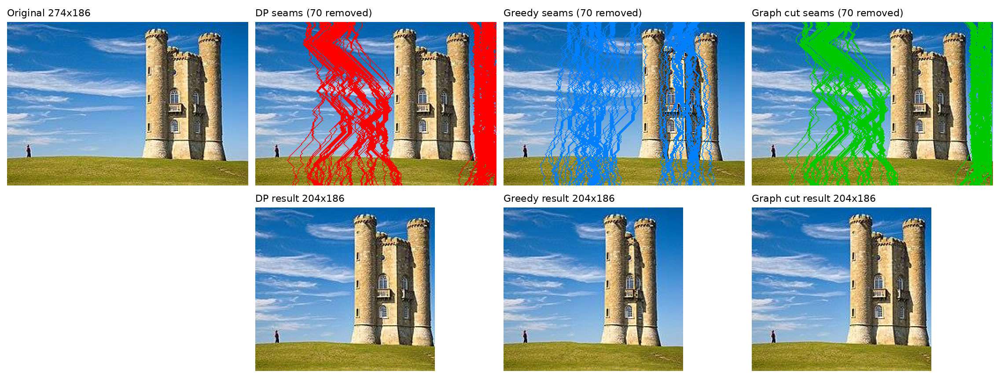

# Seam Carving: Analysis and Discussion

## 1. Implementation overview
Question 1 is implemented in the UI-independent `seamcore` library. `Energy.cpp` converts
BGR input to grayscale intensity and computes either central-difference energy
`|I(r,c+1)-I(r,c-1)| + |I(r+1,c)-I(r-1,c)|` or the absolute sum of two handwritten
3x3 Sobel responses. Both replicate the nearest pixel at image boundaries.

`DPSeamFinder.cpp` initializes cumulative costs from the first energy row. Each later
pixel adds its energy to the minimum reachable cost in the preceding row (up-left,
up or up-right). A parent table records the chosen predecessor. Backtracking from the
lowest cost in the final row returns one connected pixel per row. Equal costs select
the leftmost predecessor and final column deterministically.

`Carver.cpp` removes each selected pixel by copying the remaining pixels in that row.
It recomputes the energy map and seam after every removal (an optional incremental mode
updates only the energy next to the removed seam; section 5.3). Horizontal finding transposes
the image and reuses the vertical algorithm; horizontal removal transposes back afterward.
Resizing removes all requested vertical seams, then all requested horizontal seams.
Targets must be positive and no larger than the original. These operations shrink images;
seam insertion is not implemented.

For an H by W image, energy computation, DP and removal each take O(HW) time per seam.
The baseline cost and parent tables each take O(HW) space. Rolling cost rows reduce cost
storage to O(W), with O(HW) parent storage still required for backtracking. Removing k
seams takes at most O(kHW) time, with smaller images in successive iterations. Each
individual backward-energy seam is optimal for the current image; the complete sequence
of removals and the chosen vertical-then-horizontal order are not claimed globally optimal.

The default mode minimizes the requested sum of pixel energies. An optional forward
mode uses the first-row pixel energy and then the CL/CU/CR transition costs documented
in `Energy.h`; it optimizes a different objective. `CarveStats.totalSeamCost` always reports
the sum of backward pixel energies, including when forward mode is enabled.

Validation includes exhaustive enumeration on small maps, both energy filters,
horizontal and vertical seams, exact retained pixels, boundary cases and a controlled
test that verifies energy is recalculated after each removal. See `tests/src/q1.cpp`.
Multi-threaded DP and incremental energy updates are implemented (section 5), tested in
`tests/src/q5_threads.cpp` and `tests/src/q5_energy.cpp`.

### Greedy (Question 3)
`GreedySeamFinder.cpp` starts at the lowest-energy pixel of the top row and, in every
following row, moves to the cheapest of the (up to) three pixels below the current one.
Ties choose the leftmost candidate, as in DP. It keeps no table and never looks ahead, so it
cannot see that a cheap pixel leads into an expensive region. An optional variant
(`tryAllStarts`) runs the same rule from every top-row column and keeps the cheapest seam.
That costs O(HW) like DP but is still not optimal.

`tests/src/q3.cpp` checks the rule step by step, checks DP <= greedy(all starts) <= greedy
on 200 random energy maps, and includes a 3x3 counterexample where greedy pays 100,
greedy(all starts) 15 and DP 10.

### Graph cut (Question 4)
`GraphCutSeamFinder.cpp` builds the network described in the brief: one node per pixel plus a
source and a sink. The source connects to every first-column pixel and every last-column pixel
connects to the sink, both with infinite capacity. The edge from (i, j) to (i, j+1) has
capacity equal to the cost of removing (i, j): its energy e(i, j), or with the forward option
|I(i, j+1) - I(i, j-1)|. Its reverse edge is infinite, and so are the diagonal edges from
(i, j) to (i-1, j-1) and (i+1, j-1).

The infinite reverse edges force the source side S of every row to be a prefix of columns
(if (i, j+1) is in S, so is (i, j)), so a finite cut crosses exactly one horizontal edge per
row. The infinite diagonals stop that boundary from moving more than one column between
adjacent rows, so the removed pixels form a connected seam. After max-flow, a BFS from the
source over edges with remaining capacity gives S, and the rightmost pixel of S in each row is
removed. By the max-flow min-cut theorem the flow value equals the capacity of this cut, which
is the seam's cost, so the seam is the cheapest one the graph can represent.

One consequence of this construction: a last-column pixel is joined to the sink by an infinite
edge, so it can never be in S, and the seam can only use columns 0 to n-2. Graph cut therefore
finds the optimal seam of the image without its last column. It matches DP whenever DP's
optimal seam avoids the last column, and costs more when it does not (section 4.2). The forward
option uses only the |I(i, j+1) - I(i, j-1)| term suggested in the brief, which is not the same
objective as DP's forward mode, so all comparisons use backward energy, the default for both.

`MaxFlow.cpp` implements Edmonds-Karp (augment along a BFS shortest path until none remains)
and Dinic (BFS level graph, then a blocking flow using per-node edge pointers); the viewer can
use either, and Dinic is the default. Dinic's DFS is iterative because augmenting paths in a
seam graph can contain thousands of nodes, enough to overflow the stack with recursion.
Residual capacities at or below 1e-9 count as zero, to absorb floating-point rounding.

`tests/src/q4.cpp` checks the CLRS Figure 26.1 network (flow 23 and the cut {s, v1, v2, v4})
with both algorithms, and 300 random networks against a brute-force minimum over every s-t cut.
For seams, it compares every map size up to 6x6 against exhaustive enumeration of the seams
that avoid the last column, larger random maps against DP on the map without its last column,
and the forward option against a backward run on the |I(i, j+1) - I(i, j-1)| values. It also
checks that the last column is never removed but the first can be, a diagonal seam, a cheap but
disconnected path that must be rejected, and the Carver in both orientations.

## 2. Questions (Item 2)

### 2a(i) The number of seams grows at least exponentially in m
Choose any starting pixel in the first row. Since n > 1, every pixel has at least
two valid successors in the next row: the pixel in the same column and at least
one adjacent column. There are m - 1 transitions, and different sequences of
choices produce different seams. Thus even from one fixed starting pixel there
are at least 2^(m - 1) seams (and at least n * 2^(m - 1) over all starting
pixels). The number therefore grows exponentially in m.

### 2a(ii) Relating the problem to its subproblems
Let M(i, j) be the minimum total energy of a partial vertical seam from the top
row to pixel (i, j). The first row is the base case:

    M(1, j) = e(1, j),                     1 <= j <= n.

For each later row, a seam reaching (i, j) must come from column j - 1, j, or
j + 1 in row i - 1, provided that column is within the image. Therefore:

    M(i, j) = e(i, j) + min { M(i - 1, k) : k in {j - 1, j, j + 1}, 1 <= k <= n }.

This has optimal substructure: if an optimal seam ending at (i, j) had a
nonoptimal prefix ending at its predecessor, replacing that prefix with a
cheaper one would produce a cheaper valid seam, a contradiction. Filling the
table row by row reuses overlapping subproblems instead of enumerating seams.
The optimal total is min_j M(m, j). To recover a seam, record a minimizing
predecessor for each entry, start at a minimum in the last row, and backtrack.
This takes O(mn) time and O(mn) space with the table and predecessors. For a
horizontal seam, transpose the image and apply the same recurrence.

### 2b Can divide and conquer speed up convolution / gradient computation?
Direct convolution of an m by n image with a k by k kernel takes O(mnk^2)
time. Divide and conquer can split the image into regions, process them
independently, and combine the results, with overlapping border pixels (a halo)
where the kernel crosses a region boundary. This can enable parallel execution,
but it does not reduce the total asymptotic work for a fixed-size kernel; the
overlap and task management also add overhead.

The Sobel kernels are separable: each 3 by 3 kernel can be expressed as the
product of a one-dimensional smoothing filter and a one-dimensional derivative
filter. Applying these in two passes reduces the work for a separable k by k
kernel from O(mnk^2) to O(mnk). For a fixed 3 by 3 Sobel filter, both approaches
are already O(mn), so any gain is a constant-factor improvement that should be
measured. An FFT uses a divide-and-conquer algorithm and can accelerate
convolution with sufficiently large kernels, but padding and transform overhead
usually make it unattractive for a small Sobel kernel. The current implementation
computes the two 3 by 3 Sobel responses directly and combines their absolute
values; it does not use divide and conquer or FFTs.

## 3. Time and space complexity
| Algorithm | Time per seam | Time for k seams | Space |
|---|---|---|---|
| Energy map | O(HW) | O(kHW) | O(HW) |
| DP | O(HW) | O(kHW) | O(HW) parents (+ O(W) costs with rolling rows) |
| Greedy | O(H) | O(kH), but O(kHW) overall because energy is recomputed | O(H) for the seam |
| Greedy, all starts | O(HW) | O(kHW) | O(H) |
| Graph cut (Edmonds–Karp) | O(VE^2) = O((HW)^3) worst case | O(k(HW)^3) | O(HW): about 6HW edge records |
| Graph cut (Dinic) | O(V^2 E) = O((HW)^3) worst case; measured growth about (HW)^1.6 | O(k(HW)^3) | O(HW), same graph |
| DP, multi-threaded (p threads) | O(HW/p) work per thread + H barrier waits | O(kHW/p + kH·sync) | as DP |
| Incremental energy update | O(H) | O(kH), but O(kHW) overall because removal copies the image | as energy map |

For the incremental energy update, a seam moves at most one column per row, so over rows r-1 to
r+1 the band [lo-1, hi] spans at most 4 columns: O(1) pixels per row. For graph cut, V = HW + 2 and E = Θ(HW): each pixel has at most one right edge and two
diagonals, each stored with a residual twin, plus the source and sink edges. Because the graph
is sparse, the general bounds O(VE^2) for Edmonds-Karp and O(V^2 E) for Dinic both become
O(V^3) = O((HW)^3) per seam.

The measured growth rates come from fitting log(find time) against log(pixels) over the
100, 150 and 200 px runs in section 4.2: DP 1.03 (linear, as expected), greedy 0.64 (it
touches one pixel per row, and H grows like (HW)^0.5 at a fixed aspect ratio) and graph cut
with Dinic 1.63. Max-flow is far below its worst case on these grids, but clearly superlinear.

## 4. Comparison: DP vs Greedy vs Graph Cut

### 4.1 DP vs Greedy (Question 3)
Measured with the Release build: 100 vertical seams removed, Gradient energy, two Windows
wallpapers scaled to three widths. Raw data and images are in `results/q3/`.

| Image | Size | DP total (ms) | Greedy total (ms) | DP find (ms) | Greedy find (ms) | DP seam cost | Greedy seam cost |
|---|---|---|---|---|---|---|---|
| img100 (waves) | 200x112 | 46.5 | 23.9 | 23.1 | 0.19 | 68,163 | 117,604 |
| img100 (waves) | 400x225 | 179.8 | 81.9 | 86.1 | 0.43 | 63,368 | 116,183 |
| img100 (waves) | 800x450 | 696.8 | 360.0 | 345.4 | 1.44 | 43,251 | 160,274 |
| img102 (sunset) | 200x125 | 48.0 | 28.6 | 24.6 | 0.21 | 58,963 | 112,496 |
| img102 (sunset) | 400x250 | 214.8 | 101.0 | 110.7 | 0.40 | 56,706 | 124,007 |
| img102 (sunset) | 800x500 | 866.7 | 390.6 | 472.0 | 2.35 | 62,771 | 191,015 |

Observations:
- **Greedy finds seams much faster, but carving is only about 2x faster.** Finding a seam is
  about 120-280x faster with greedy (O(H) vs O(HW)). The whole carve, however, is only about 2x
  faster, because recomputing the O(HW) energy map after every removal dominates.
- **Greedy seams cost 1.7-3.7x more energy, and the gap grows with image size.** More rows give
  greedy more chances to be led into an expensive region.
- **DP keeps the left mountain and the sun intact, while greedy squashes the mountain**
  (`img102-original-dp-greedy.png`).
- **Lower energy is not always better-looking.** On `img100`, DP concentrates seams along the
  curved edges and leaves staircase artifacts, while greedy happens to look smoother.
- **Backward energy ignores new edges.** Backward energy ignores the new edges created by a
  removal. Forward energy is designed to fix exactly this; see section 5.3.

### 4.2 DP vs Graph cut (Question 4)
Measured with g++ 13.3 `-O2` on Linux (2-core Xeon, 2.1 GHz): 30 vertical seams removed,
Gradient energy, graph cut with Dinic, median of 3 runs. This is a different machine and
compiler from section 4.1, so compare ratios across the two tables, not absolute times. The
input is the tower image from the assignment brief (`assets/images/tower.jpg`), scaled so the
longer side is the given size. Summary data: `docs/data/q4-bench-summary.csv`. Reproduce with
`seam_bench --image assets/images/tower.jpg --sizes 100,150,200 --seams 30 --algos dp,greedy,graphcut`.

| Size | DP find per seam (ms) | Graph cut find per seam (ms) | Graph cut ÷ DP time | DP total seam cost | Graph cut total seam cost | Graph cut ÷ DP cost |
|---|---|---|---|---|---|---|
| 100x68 | 0.028 | 24.7 | 868x | 23,308 | 24,013 | 1.030 |
| 150x102 | 0.068 | 90.4 | 1,329x | 24,090 | 24,808 | 1.030 |
| 200x136 | 0.118 | 237.3 | 2,019x | 25,316 | 25,832 | 1.020 |

Observations:
- **Nearly the same seams as DP, slightly more expensive.** Graph cut's total seam cost is
  2.0-3.0% higher than DP's. The reason is the last column: many of DP's seams on this image
  run down the right-hand edge of the sky, but graph cut cannot remove the last column, so it
  takes the next-cheapest seams instead. Removing 70 seams from the full 274x186 tower, only 262
  of the 13,020 removed pixels (2%) differ from DP's, and the results look the same. On maps
  where it is allowed the same columns, graph cut matches DP's cost exactly (tested).
- **Graph cut is far slower.** Per seam it is 868-2,019x slower than DP, and the gap grows with
  the image because DP is linear in the number of pixels while max-flow grew like about
  (HW)^1.6 here. DP visits each pixel once with three comparisons; graph cut builds a graph of
  about 6HW edge records and runs max-flow on it for every seam.
- **Greedy, for reference**, costs 2.0-2.9x as much energy as DP, and its seams cut through the
  central tower, while DP and graph cut take theirs from the sky and the right-hand side.
- **When graph cut is worth it.** For a single image it gives no quality advantage over DP and
  costs orders of magnitude more time. Its value is generality: Rubinstein et al. (2008) use a
  min-cut construction for video, where a seam becomes a connected surface through all frames
  and the row-by-row DP recurrence no longer applies.
- **Edmonds-Karp vs Dinic.** Same costs, and Dinic is about 3x faster per seam on this machine:
  50x34 EK 5.54 vs Dinic 1.89 ms/seam (2.9x), 75x51 25.05 vs 8.26 (3.0x), 100x68 61.20 vs 19.53
  (3.1x). Costs are identical (5542, 5865, 5897). Data: `docs/data/q5-maxflow.csv` (10 seams, the
  Windows machine of section 5).

## 5. Improvements
Setup for all measurements in this section: Windows, AMD Ryzen 7 5800X3D (8 cores, 16 threads),
MSVC Release build, `seam_bench` on `assets/images/tower.jpg`. Sizes above 274 px are upscaled
(INTER_AREA), so they are smoother than native photos. Each number is the median of 3 runs.
Summary data is in `docs/data/q5-*.csv`; raw runs are in `results/q5/`. Run-to-run variation is
about 10% (for example, 1600x1086 DP with one thread found a seam in 18.66 ms/seam in the threads
experiment and 16.70 ms/seam in the rolling experiment), so differences under about 10% are
within noise.

### 5.1 Do we need the entire DP table?
No, not for the costs. Row i depends only on row i-1, so two cost rows (O(W) memory) are enough.
This is implemented as `DPOptions::rollingRows`. The parent table is still O(HW), because
backtracking needs the chosen predecessor of every pixel in every row.

DP, 1 thread, 20 seams, Gradient energy:

| Size | Full find (ms/seam) | Rolling find (ms/seam) | Full memory (MB) | Rolling memory (MB) |
|---|---|---|---|---|
| 400x272 | 1.24 | 1.10 | 1.31 | 0.44 |
| 800x543 | 3.91 | 3.52 | 5.21 | 1.75 |
| 1600x1086 | 16.70 | 13.39 | 20.85 | 6.98 |
| 3200x2172 | 67.88 | 55.71 | 83.40 | 27.85 |

The full table needs 8HW bytes for double costs plus 4HW for int parents, about 12HW in total.
Rolling rows need 16W + 4HW, about 3x less at every size shown. Rolling rows were 11-25% faster,
probably because the smaller working set fits the cache better, but the gains at the smaller sizes
are at the noise level. Total seam costs are identical (for example 18,119 at 400x272 with either
method), and the seams are identical (tests).

Further reductions are not implemented. Storing each parent as a 1-byte offset (-1, 0, +1) instead
of a 4-byte int would cut the parent table 4x. Alternatively, a Hirschberg-style divide and conquer
could avoid the parent table entirely by recomputing costs, giving O(W) memory for roughly
O(HW log H) time.

### 5.2 Does multi-threading help?
Rows depend on the previous row, so the rows stay sequential. Within a row, the columns are split
into contiguous blocks, one per thread. Threads are created once per seam and meet at a
`std::barrier` after every row (`core/src/DPSeamFinder.cpp`). One barrier per row is enough even
with rolling rows, because buffer r%2 is only overwritten two rows later. Seams are identical to
the single-thread result (960 test cases plus a race stress test).

DP, Gradient, 20 seams, find time per seam in ms (speed-up relative to 1 thread):

| Size | 1 thread | 2 threads | 4 threads | 8 threads | 16 threads |
|---|---|---|---|---|---|
| 400x272 | 1.30 | 1.22 (1.07x) | 1.71 (0.76x) | 5.34 (0.24x) | 10.27 (0.13x) |
| 800x543 | 4.91 | 5.51 (0.89x) | 5.40 (0.91x) | 10.70 (0.46x) | 15.74 (0.31x) |
| 1600x1086 | 18.66 | 17.22 (1.08x) | 15.59 (1.20x) | 22.81 (0.82x) | 30.03 (0.62x) |
| 3200x2172 | 74.84 | 47.19 (1.59x) | 46.69 (1.60x) | 58.00 (1.29x) | 66.78 (1.12x) |

Each row is only W cells of very cheap work (three comparisons), but every row costs one barrier
synchronisation of all threads, H times per seam. Only at 3200 px wide is a row long enough to
amortise that cost, and even there the best result is 1.6x with 2-4 threads. More threads add
synchronisation cost, and 16 threads run on SMT siblings of the 8 cores.

The whole-carve gain is smaller still. At 3200 px, total time falls from 3388.6 ms (1 thread) to
2620.1 ms (4 threads), about 1.3x, because energy computation and removal are not threaded
(Amdahl's law).

Conclusion: multi-threading the DP recurrence does not pay off at normal image sizes. Better
targets would be the energy map, where every pixel is independent and no per-row barrier is
needed, or running independent work in parallel, such as the vertical and horizontal candidates.
Neither is implemented.

### 5.3 Other improvements
**(i) Local (incremental) energy updates.** Enabled with `Carver::setIncrementalEnergy`. Both
filters read only a pixel's 3x3 window. After a seam is removed, only columns [lo-1, hi] of row r
can change, where lo and hi are the minimum and maximum seam column over rows r-1 to r+1. The rest
of the energy map is shifted along with the image. The energy maps are bit-identical to full
recomputation (`tests/src/q5_energy.cpp`: 4512 cases, 16608 removals), and seam costs are identical
in every benchmark row.

50 seams, times in ms, off -> on:

| Algorithm | Energy | Size | Energy time | Total time | Speed-up (total) |
|---|---|---|---|---|---|
| DP | Gradient | 400x272 | 69.14 -> 1.94 | 137.5 -> 78.0 | 1.8x |
| DP | Gradient | 1600x1086 | 996.2 -> 22.6 | 1942.9 -> 1053.7 | 1.8x |
| Greedy | Gradient | 400x272 | 66.21 -> 2.00 | 74.50 -> 19.31 | 3.9x |
| Greedy | Gradient | 1600x1086 | 965.2 -> 21.1 | 1024.3 -> 207.6 | 4.9x |
| DP | Sobel | 1600x1086 | 1841.0 -> 41.5 | 2757.4 -> 1061.3 | 2.6x |
| Greedy | Sobel | 1600x1086 | 1873.6 -> 41.4 | 1932.2 -> 235.3 | 8.2x |

The full tables are in `docs/data/q5-incremental_gradient.csv` and `docs/data/q5-incremental_sobel.csv`.
Energy time falls by roughly 24-46x across the sizes measured. Greedy gains most, because energy
was almost all of its time (section 4.1). Removal time rises, because three maps (image, gray and
energy) are copied per seam instead of one. Asymptotically each seam is still O(HW), because
removal copies the image; the improvement is a constant factor.

**(ii) Forward energy** (Rubinstein et al. 2008). Enabled with `DPOptions::forwardEnergy`. It
charges the new edges that appear when neighbours become adjacent after a removal (the CL, CU and
CR costs). On the 274x186 tower with 80 seams, find time rises from 0.539 to 0.862 ms/seam (1.6x
slower), and total time from 93.9 to 118.0 ms. Seam costs measure a different objective, so they
are not comparable.

On this image both versions keep the tower and the person intact, and the results look very
similar. The difference is expected on images with curved or diagonal edges, such as the staircase
artifacts on img100 noted in section 4.1. Those were not re-measured here.

**(iii) Not implemented.** Choosing the optimal order of vertical and horizontal removals with a
second DP (Avidan and Shamir, 2007), and seam insertion for enlarging images.

## References
- S. Avidan, A. Shamir. *Seam Carving for Content-Aware Image Resizing.* SIGGRAPH 2007.
- M. Rubinstein, A. Shamir, S. Avidan. *Improved Seam Carving for Video Retargeting.* SIGGRAPH 2008.
- Cormen et al. *Introduction to Algorithms*, Problem 15-8 (Image compression by seam carving).
- Cormen et al. *Introduction to Algorithms*, Chapter 26 (Maximum flow: Ford-Fulkerson, Edmonds-Karp, max-flow min-cut theorem).
- E. A. Dinic. *Algorithm for Solution of a Problem of Maximum Flow in a Network with Power Estimation.* Soviet Math. Doklady, 1970.
- J. Edmonds, R. M. Karp. *Theoretical Improvements in Algorithmic Efficiency for Network Flow Problems.* JACM, 1972.
