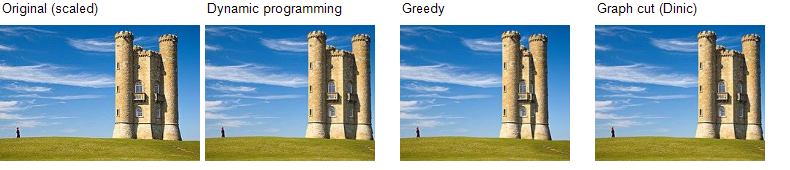
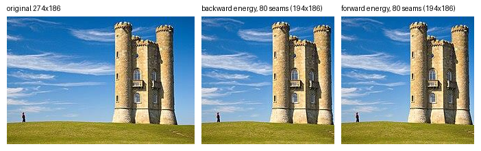

# Seam Carving: Analysis and Discussion

## 1. Implementation overview
Question 1 is implemented in the UI-independent `seamcore` library. `Energy.cpp` converts
BGR input to grayscale intensity and computes either central-difference energy
`|I(r,c+1)-I(r,c-1)| + |I(r+1,c)-I(r-1,c)|` or the absolute sum of two handwritten
3x3 Sobel responses. Both replicate the nearest pixel at image boundaries.

`DPSeamFinder.cpp` initializes cumulative costs from the first energy row. Each later
pixel adds its energy to the minimum reachable cost in the preceding row (up-left,
up or up-right). A parent table records the chosen predecessor. Backtracking from the
lowest cost in the final row returns one connected pixel per row. Equal costs select
the leftmost predecessor and final column deterministically.

`Carver.cpp` removes each selected pixel by copying the remaining pixels in that row.
It recomputes the energy map and seam after every removal (an optional incremental mode
updates only the energy next to the removed seam; section 5.3). Horizontal finding transposes
the image and reuses the vertical algorithm; horizontal removal transposes back afterward.
Resizing removes all requested vertical seams, then all requested horizontal seams.
Targets must be positive and no larger than the original. These operations shrink images;
seam insertion is not implemented.

For an H by W image, energy computation, DP and removal each take O(HW) time per seam.
The baseline cost and parent tables each take O(HW) space. Rolling cost rows reduce cost
storage to O(W), with O(HW) parent storage still required for backtracking. Removing k
seams takes at most O(kHW) time, with smaller images in successive iterations. Each
individual backward-energy seam is optimal for the current image; the complete sequence
of removals and the chosen vertical-then-horizontal order are not claimed globally optimal.

The default mode minimizes the requested sum of pixel energies. An optional forward
mode uses the first-row pixel energy and then the CL/CU/CR transition costs documented
in `Energy.h`; it optimizes a different objective. `CarveStats.totalSeamCost` always reports
the sum of backward pixel energies, including when forward mode is enabled.

Validation includes exhaustive enumeration on small maps, both energy filters,
horizontal and vertical seams, exact retained pixels, boundary cases and a controlled
test that verifies energy is recalculated after each removal. See `tests/src/q1.cpp`.
Multi-threaded DP and incremental energy updates are implemented (section 5), tested in
`tests/src/q5_threads.cpp` and `tests/src/q5_energy.cpp`.

### Greedy (Question 3)
`GreedySeamFinder.cpp` starts at the lowest-energy pixel of the top row and, in every
following row, moves to the cheapest of the (up to) three pixels below the current one.
Ties choose the leftmost candidate, as in DP. It keeps no table and never looks ahead, so it
cannot see that a cheap pixel leads into an expensive region. An optional variant
(`tryAllStarts`) runs the same rule from every top-row column and keeps the cheapest seam.
That costs O(HW) like DP but is still not optimal.

`tests/src/q3.cpp` checks the rule step by step, checks DP <= greedy(all starts) <= greedy
on 200 random energy maps, and includes a 3x3 counterexample where greedy pays 100,
greedy(all starts) 15 and DP 10.

### Graph cut (Question 4)
`GraphCutSeamFinder.cpp` builds one node per pixel and an extra boundary node at the
right of each row, plus a source and sink. The source connects to each first-column node;
each boundary node connects to the sink. The edge leaving pixel (i, j) to the right has
capacity e(i, j). Infinite-capacity reverse and diagonal edges force each finite cut to
cross each row once and the cut positions in adjacent rows to differ by at most one.
The extra boundary allows the cut to select the last column, which is excluded if the
last pixel itself is pinned to the sink as in the brief. A single-column image has one
possible seam and is handled directly.

After max-flow, residual BFS identifies the source side; its rightmost pixel in each row
is the seam. By the max-flow min-cut theorem, this is a minimum-energy connected seam
for the current image. For horizontal seams the image is transposed. The graph-cut forward
option uses only the |I(i, j+1) - I(i, j-1)| term suggested in the brief, which differs
from DP's full forward objective; comparisons between algorithms use backward energy.

`MaxFlow.cpp` implements Edmonds-Karp (augment along a BFS shortest path until none remains)
and Dinic (BFS level graph, then a blocking flow using per-node edge pointers); the viewer can
use either, and Dinic is the default. Dinic's DFS is iterative because augmenting paths in a
seam graph can contain thousands of nodes, enough to overflow the stack with recursion.
Residual capacities at or below 1e-9 count as zero, to absorb floating-point rounding.

`tests/src/q4.cpp` checks the CLRS Figure 26.1 network (flow 23 and the cut {s, v1, v2, v4})
with both algorithms, and 300 random networks against a brute-force minimum over every s-t cut.
For seams, it compares every map size up to 6x6 against exhaustive enumeration over all
columns, larger random maps against DP on the complete map,
and the forward option against a backward run on the |I(i, j+1) - I(i, j-1)| values. It also
checks both edge columns, a diagonal seam, a cheap but
disconnected path that must be rejected, and the Carver in both orientations.

## 2. Questions (Item 2)

### 2a(i) The number of seams grows at least exponentially in m
Choose any starting pixel in the first row. Since n > 1, every pixel has at least
two valid successors in the next row: the pixel in the same column and at least
one adjacent column. There are m - 1 transitions, and different sequences of
choices produce different seams. Thus even from one fixed starting pixel there
are at least 2^(m - 1) seams (and at least n * 2^(m - 1) over all starting
pixels). The number therefore grows exponentially in m.

### 2a(ii) Relating the problem to its subproblems
Let M(i, j) be the minimum total energy of a partial vertical seam from the top
row to pixel (i, j). The first row is the base case:

    M(1, j) = e(1, j),                     1 <= j <= n.

For each later row, a seam reaching (i, j) must come from column j - 1, j, or
j + 1 in row i - 1, provided that column is within the image. Therefore:

    M(i, j) = e(i, j) + min { M(i - 1, k) : k in {j - 1, j, j + 1}, 1 <= k <= n }.

This has optimal substructure: if an optimal seam ending at (i, j) had a
nonoptimal prefix ending at its predecessor, replacing that prefix with a
cheaper one would produce a cheaper valid seam, a contradiction. Filling the
table row by row reuses overlapping subproblems instead of enumerating seams.
The optimal total is min_j M(m, j). To recover a seam, record a minimizing
predecessor for each entry, start at a minimum in the last row, and backtrack.
This takes O(mn) time and O(mn) space with the table and predecessors. For a
horizontal seam, transpose the image and apply the same recurrence.

### 2b Can divide and conquer speed up convolution / gradient computation?
Direct convolution of an m by n image with a k by k kernel takes O(mnk^2)
time. Divide and conquer can split the image into regions, process them
independently, and combine the results, with overlapping border pixels (a halo)
where the kernel crosses a region boundary. This can enable parallel execution,
but it does not reduce the total asymptotic work for a fixed-size kernel; the
overlap and task management also add overhead.

The Sobel kernels are separable: each 3 by 3 kernel can be expressed as the
product of a one-dimensional smoothing filter and a one-dimensional derivative
filter. Applying these in two passes reduces the work for a separable k by k
kernel from O(mnk^2) to O(mnk). For a fixed 3 by 3 Sobel filter, both approaches
are already O(mn), so any gain is a constant-factor improvement that should be
measured. An FFT uses a divide-and-conquer algorithm and can accelerate
convolution with sufficiently large kernels, but padding and transform overhead
usually make it unattractive for a small Sobel kernel. The current implementation
computes the two 3 by 3 Sobel responses directly and combines their absolute
values; it does not use divide and conquer or FFTs.

## 3. Time and space complexity
| Algorithm | Time per seam | Time for k seams | Space |
|---|---|---|---|
| Energy map | O(HW) | O(kHW) | O(HW) |
| DP | O(HW) | O(kHW) | O(HW) parents (+ O(W) costs with rolling rows) |
| Greedy | O(H) | O(kH), but O(kHW) overall because energy is recomputed | O(H) for the seam |
| Greedy, all starts | O(HW) | O(kHW) | O(H) |
| Graph cut (Edmonds–Karp) | O(VE^2) = O((HW)^3) worst case | O(k(HW)^3) | O(HW): about 6HW edge records |
| Graph cut (Dinic) | O(V^2 E) = O((HW)^3) worst case | O(k(HW)^3) | O(HW), same graph |
| DP, multi-threaded (p threads) | O(HW/p) work per thread + H barrier waits | O(kHW/p + kH·sync) | as DP |
| Incremental energy update | O(H) | O(kH), but O(kHW) overall because removal copies the image | as energy map |

For the incremental energy update, a seam moves at most one column per row, so over rows r-1 to
r+1 the band [lo-1, hi] spans at most 4 columns: O(1) pixels per row. For graph cut, V = H(W + 1) + 2 and E = Θ(HW): each pixel has at most one right edge and two
diagonals, each stored with a residual twin, plus the source and sink edges. Because the graph
is sparse, the general bounds O(VE^2) for Edmonds-Karp and O(V^2 E) for Dinic both become
O(V^3) = O((HW)^3) per seam.

## 4. Comparison: DP vs Greedy vs Graph Cut

The following measurements use the corrected graph, the Release build (MSVC) on Windows
with a Ryzen 7 5700X (8 cores, 16 threads), and the tower image included in the project.
Each run removes 30 vertical seams using gradient energy, one DP thread, and Dinic for graph
cut. The image is resized conventionally to each size before carving. Times are medians of
three runs, in milliseconds for all 30 seams. The three raw CSV files are
[current-comparison-run1.csv](data/current-comparison-run1.csv),
[current-comparison-run2.csv](data/current-comparison-run2.csv), and
[current-comparison-run3.csv](data/current-comparison-run3.csv).

| Image size | Algorithm | Seam finding (ms) | Total (ms) | Sum of seam energies |
|---|---|---:|---:|---:|
| 100 x 68 | DP | 2.781 | 6.011 | 23,308 |
| 100 x 68 | Greedy | 0.033 | 3.436 | 46,090 |
| 100 x 68 | Graph cut | 742.829 | 746.196 | 23,308 |
| 150 x 102 | DP | 5.673 | 12.394 | 24,090 |
| 150 x 102 | Greedy | 0.044 | 6.834 | 69,277 |
| 150 x 102 | Graph cut | 2,493.070 | 2,501.310 | 24,090 |
| 200 x 136 | DP | 10.095 | 21.665 | 25,316 |
| 200 x 136 | Greedy | 0.055 | 10.036 | 68,255 |
| 200 x 136 | Graph cut | 6,433.730 | 6,447.770 | 25,316 |

**Greedy versus DP.** The greedy seams have about 2.0-2.9 times the total energy on
these runs. Finding them is much faster, but total carving takes roughly half the DP time,
because energy calculation and copying still visit much of the image. On this particular
image, all three results preserve the main tower and look broadly similar at this scale;
the higher greedy cost does not by itself establish a visible quality difference. Other
images, especially those with more important detail across the frame, may show a different
result. A local decision cannot guarantee a minimum-energy seam.

**Graph cut versus DP.** Their totals match at all three sizes in this experiment. The
algorithms minimise the same backward-energy objective for each current image, although
ties can produce different seams and subsequent images. The exhaustive and DP comparisons
in the tests independently check individual seams, including both edges. In the displayed
result the two images look very similar. Graph-cut seam finding is about 267-637 times
slower on these runs, including graph construction, so DP is the practical choice for this
single-image objective. These are measurements on one image and machine, not general
performance guarantees.

## 5. Improvements

Measurements in this section use the same machine, image, gradient energy and Release build.
Each run removes 10 vertical seams; the table gives the median total time of three runs in
milliseconds. The 800- and 1600-pixel inputs are upscaled from the 274 x 186 source, so
results should not be generalised to all photographs. Raw CSVs are in [data/](data/), named
`current-base-run*.csv`, `current-rolling-run*.csv`, `current-threads4-run*.csv`,
and `current-incremental-run*.csv`. Timing variation and the small sample size limit the
strength of the conclusions.

| Image size | Baseline | Rolling rows | 4 DP threads | Incremental energy |
|---|---:|---:|---:|---:|
| 400 x 272 | 26.505 | 24.792 | 33.669 | 16.576 |
| 800 x 543 | 99.671 | 94.877 | 103.550 | 66.881 |
| 1600 x 1086 | 393.832 | 370.124 | 348.344 | 239.707 |

### 5.1 Do we need the entire DP table?

No: the cost for a row depends only on the preceding row, so rolling rows reduce cost
storage from O(HW) to O(W). The implementation still stores O(HW) parent entries to
reconstruct the seam. The rolling version produced the same total seam costs as baseline
in these runs and was modestly faster; this may reflect cache effects and timing variation.
Other memory-saving reconstruction methods would involve additional work or recomputation.

### 5.2 Does multi-threading help?

Pixels within one DP row can be processed in parallel, but each row must wait for the
previous row. Here four threads were slower at 400 and 800 pixels and improved total time
by about 12% at 1600 pixels. Thread creation, row barriers, and the unchanged serial energy
and removal work limit the benefit. This is a small experiment, not a universal threshold.
The thread tests check the result against single-threaded DP.

### 5.3 Other improvements

**Incremental energy.** After a seam is removed, the implementation reuses and shifts the
energy map, recomputing only a narrow band next to the seam. Median energy time for ten
seams at 1600 x 1086 fell from 215.730 ms to 23.288 ms, including the initial full energy
calculation; total time fell from 393.832 ms to 239.707 ms. The result costs match baseline,
and tests compare the updated maps with full recomputation. Image and map copying still
require O(HW) work per seam.

**Forward energy.** An optional DP mode considers costs of new edges formed by a removal;
it optimises a different objective from the backward-energy comparison above. The figure
below, recovered from the existing Word report, shows an earlier run on the tower. Both
results look similar on this example; this alone does not demonstrate a quality advantage.

## References
- S. Avidan, A. Shamir. *Seam Carving for Content-Aware Image Resizing.* SIGGRAPH 2007.
- M. Rubinstein, A. Shamir, S. Avidan. *Improved Seam Carving for Video Retargeting.* SIGGRAPH 2008.
- Cormen et al. *Introduction to Algorithms*, Problem 15-8 (Image compression by seam carving).
- Cormen et al. *Introduction to Algorithms*, Chapter 26 (Maximum flow: Ford-Fulkerson, Edmonds-Karp, max-flow min-cut theorem).
- E. A. Dinic. *Algorithm for Solution of a Problem of Maximum Flow in a Network with Power Estimation.* Soviet Math. Doklady, 1970.
- J. Edmonds, R. M. Karp. *Theoretical Improvements in Algorithmic Efficiency for Network Flow Problems.* JACM, 1972.
